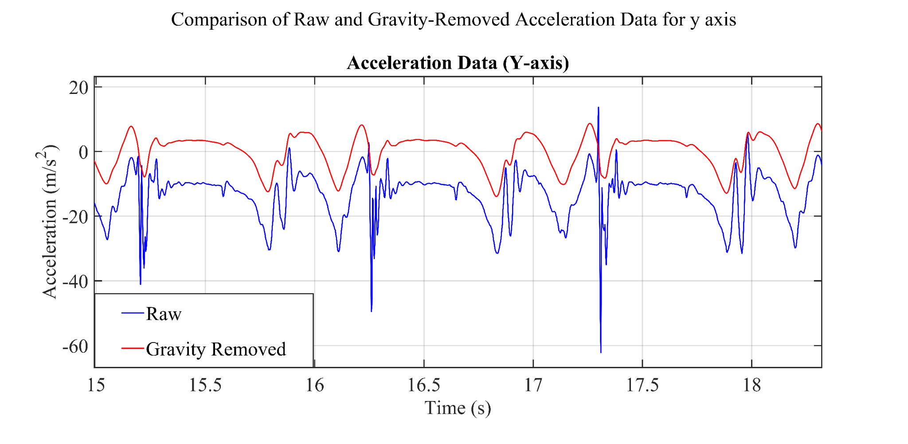
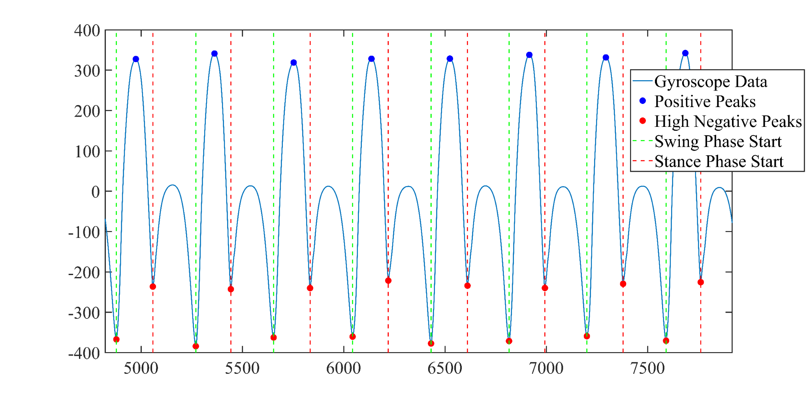
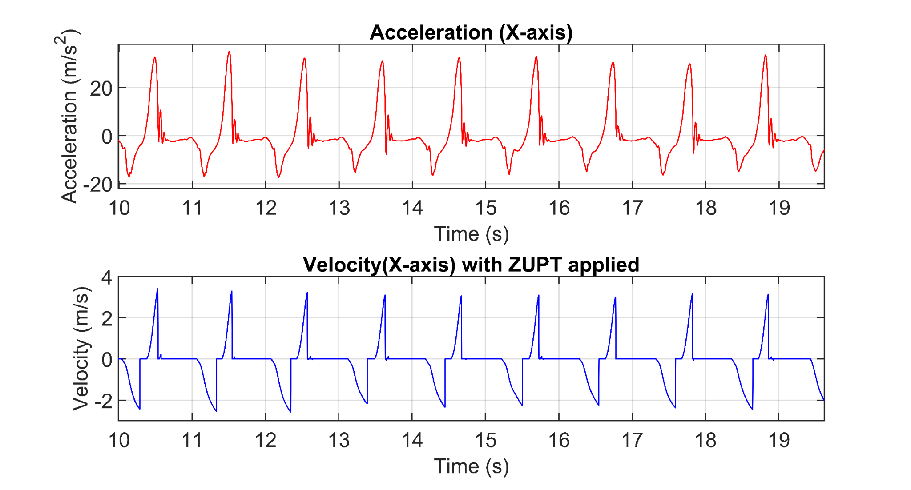
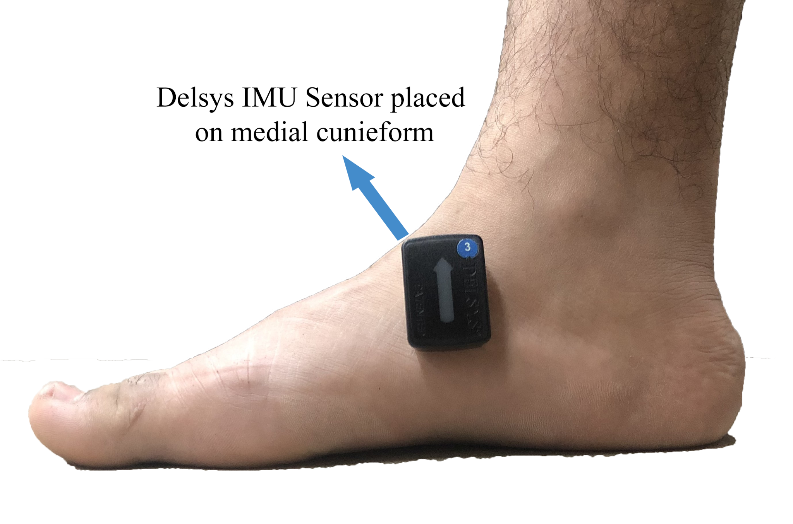
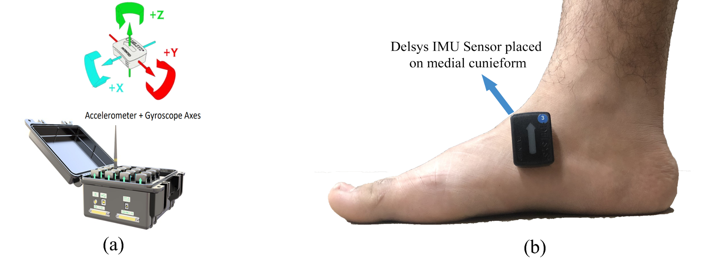

# Foot-mounted IMU gait analysis in MATLAB

**MSc research code and figure archive — gait biomechanics, wearable IMUs and movement symmetry**

This repository documents a MATLAB workflow developed during an MSc Biomedical Engineering research project on gait symmetry in active and sedentary adults and a four-week flexibility programme. The study used bilateral foot-mounted Delsys Trigno Avanti IMUs and investigated gait-event timing, stance/swing characteristics and left–right movement symmetry.

## Project origins
- **Original research:** *Enhancing Gait Symmetry: The Impact of Prolonged Sitting and the Efficacy of Flexibility Exercises* (MSc thesis, NUST Islamabad).
- **Related research output:** *Gait Symmetry in Active and Sedentary Adults and Changes Following a Four-Week Flexibility Programme*. [DOI: 10.5281/zenodo.22957465](https://doi.org/10.5281/zenodo.22957465).
- Original MATLAB scripts are included in `original_matlab_redacted/`. Participant-identifying recording names and participant-level timestamps were withheld or redacted for safe public review.
- The documented, corrected MATLAB-only implementation is in `matlab/`. **There is no Python implementation or synthetic dataset in this repository.**

## What the code does
- Loads a raw IMU workbook with time in column 1 and foot-mounted IMU acceleration / gyroscope channels in columns 8–13.
- Applies Butterworth band-pass filtering to the relevant gyro signal.
- Identifies possible toe-off, mid-swing and heel-strike events from angular-velocity peaks.
- Estimates stride, swing and stance timing and two-step cadence from verified event order.
- Computes left/right stance overlap (double support) from provided event intervals.
- Implements a paired symmetry-index helper consistent with the thesis expression.

## Research figures supplied by the researcher
The images below are the **exact image files supplied by the researcher for this repository**, without recreating or altering the underlying plots. They are not outputs of the revised MATLAB implementation and have not been independently checked against the final journal/preprint PDF.

**Raw and gravity-removed Y-axis acceleration**



**Gyroscope signal and gait-event annotations**



**Acceleration and ZUPT-corrected velocity**



**Delsys IMU placement on the medial cuneiform**



**Delsys setup and sensor axes**



See `docs/FIGURE_PROVENANCE.md` for original filenames, SHA-256 checksums and limitations.

## Running MATLAB code with authorised original IMU data
MATLAB and Signal Processing Toolbox are required for `butter`, `filtfilt`, and `findpeaks`.

```matlab
addpath('matlab')
results = analyse_imu_gait('path/to/approved_recording.xlsx', ...
    'AccelerationUnits','g', ...
    'GyroscopeUnits','deg/s', ...
    'GyroPositiveThreshold',200, ...
    'GyroNegativeThreshold',30, ...
    'OutputDir','results');
```

Confirm the recording's time unit, columns and sensor-axis convention **before running**; original plotting used recorded sample indices in places, while the revised script uses real timestamps. Peak thresholds are trial-dependent and need visual inspection. The run writes `stride_intervals.csv`, `summary.txt`, `gyro_gait_events.png` and `acceleration_filtered.png` to the chosen output directory.

The `original_matlab_redacted/` folder is a source archive and is not designed to run as-is. Run `tests/test_double_support.m` in MATLAB for basic calculation checks.

## Data and validation
The original raw IMU Excel recording was not provided. No participant-level data or newly invented replacements are included.  

## Sharing and academic provenance
The original experimental work is the basis for this repository; MATLAB maintenance and documentation were prepared later. The repository should not be used to claim that all revised scripts were used in the published study. 